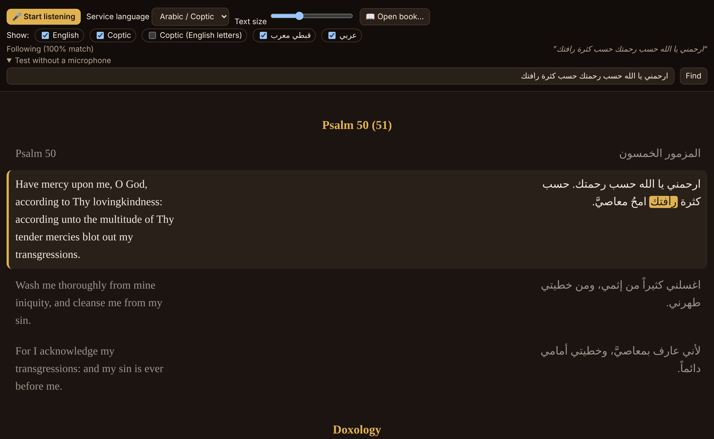
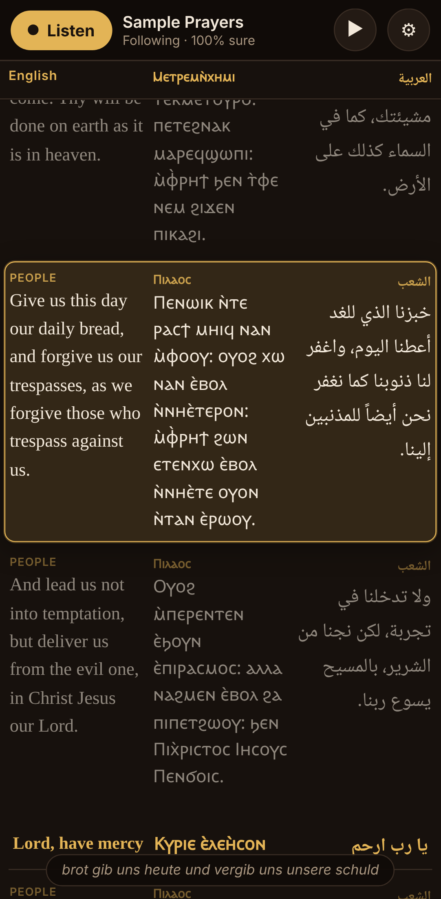
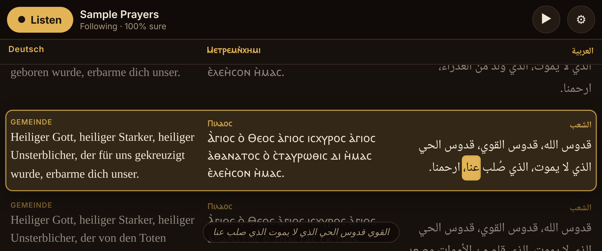
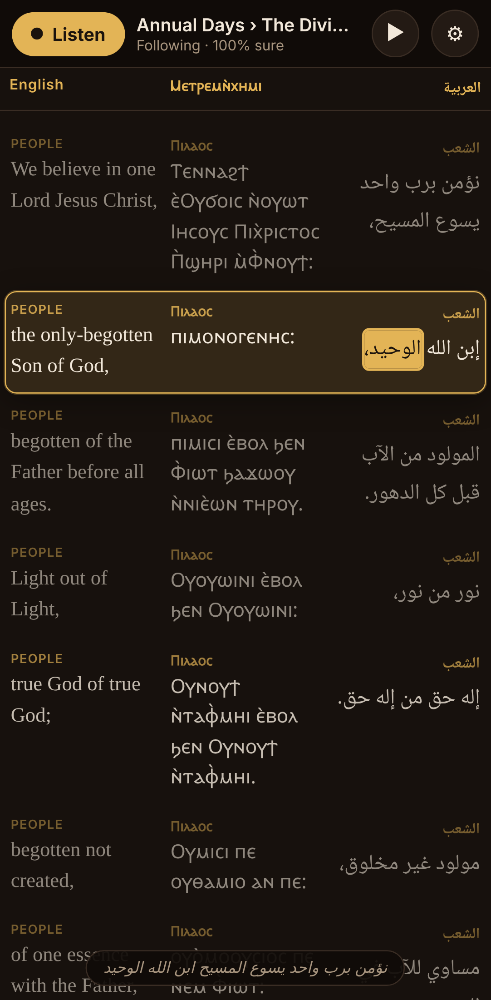

# Coptic AI Reader

An app for church: it **listens to the service and shows you where you are in the prayer book**. It highlights the paragraph and the word being read right now, and keeps scrolling as the service goes on.



**Reading screen:** three columns, **English or German | Coptic | Arabic**, like a printed service book.
- The row being read is framed in gold and the current word is marked.
- The page scrolls to keep it in view. If you scroll by hand, auto-follow pauses until you tap "Back to current".
- ⚙ settings: third column (English / Deutsch); Coptic shown in Coptic, Latin or Arabic letters; the language the priest is speaking; text size; show or hide each column.
- ▶ demo: plays through the book with the real matcher, so you can see the highlighting without a live service.
- Coptic and Arabic fonts are bundled (`fonts/`, SIL Open Font License), so it works offline on any phone.

| Phone, portrait (English) | Phone, landscape (Deutsch) |
|---|---|
|  |  |

## Install the Android app

1. On your phone, open **https://github.com/PetermHanna/Coptic-AI-Reader/releases/tag/app-latest** and download **CopticReader.apk** (about 380 MB, mostly the Coptic AI).
2. Open the download. Android asks to allow installing from this source: allow it, then **Install**.
3. Open **Coptic Reader**, pick a book in ⚙, set **The priest is speaking** to the language, and tap **Listen**:
   - **Coptic (sound AI)**: the AI model inside the app listens and follows the Coptic text by sound, fully on the phone, without internet. The first start takes a few seconds to prepare the model.
   - **Arabic / Deutsch / English**: Android's own speech recognizer follows the words.

Every push rebuilds the app (`.github/workflows/android.yml`) and replaces the release. New versions install over the old one.

**How the app is built** (`android/`): a native Kotlin app. Its screen is the same three-column book view (`index.html`, `src/`), bundled inside the app. Native parts: `CopticListener.kt` (microphone → 5 s window → wav2vec2 phoneme model via ONNX Runtime → sounds → `src/sounds.js` finds them in the Coptic text) and `WordListener.kt` (Android speech recognizer). The model is converted by `tools/export_model.py` (facebook/wav2vec2-xlsr-53-espeak-cv-ft, Apache-2.0, 8-bit, ~320 MB).

## Books

- `books/sample.json`: a short sample in English, **German**, Coptic and Arabic.
- `books/tasbeha/`: **772 hymns and responses, about 19,000 lines**, in Coptic, Coptic in Latin letters, English and Arabic. Collected from the tasbeha.org hymn library with `tools/tasbeha_crawl.py` (credit: tasbeha.org) and grouped by season and service: Psalmody, the Divine Liturgy, Raising of Incense, Kiahk, Holy Pascha Week, the feasts, Great Lent, Matrimony and more. Pick a book in ⚙ settings. These books have no German, so the third column falls back to English.



## Cost: free

- **Speech recognition**: the browser's built-in Web Speech API (Chrome, Edge, Safari, Android, iPhone). No API key, no server, no fees.
- **Matching**: a small JavaScript file (`src/matcher.js`) that runs on the phone itself. No AI service is called.
- **Hosting**: plain static files. Free on GitHub Pages, Netlify or Cloudflare Pages.

## How it works

1. The phone's speech recognizer turns what the priest or deacon says into text.
2. The matcher compares the last ~8 words against every column of the book, using fuzzy letter-trigram matching. This tolerates misheard words, missing Arabic diacritics and spelling differences.
3. Text just ahead of the current position gets a bonus, so repeated prayers (e.g. the Trisagion's "Holy God, Holy Mighty…") move forward instead of jumping back.
4. **Coptic trick**: no speech recognizer understands Coptic. But if the service language is set to *Arabic / Coptic*, the Arabic recognizer writes Coptic *sounds* in Arabic letters. Those get matched against the book's "قبطي معرب" (Coptic in Arabic letters) column. The English recognizer does the same with the "Coptic in English letters" column.

## Run it

```bash
npm start        # serves on http://localhost:8080
npm test         # matcher tests
```

The microphone only works on `https://` or `localhost`. To test without speaking, open **"Test without a microphone"** and type a few words.

## Adding prayer books

A book is one JSON file (see `books/sample.json`):

```json
{
  "title": "...",
  "languages": { "en": "English", "de": "Deutsch", "cop": "Coptic", "cop_ar": "قبطي معرب", "ar": "عربي" },
  "roles": { "priest": { "en": "Priest", "de": "Priester", "ar": "الكاهن" } },
  "paragraphs": [
    { "id": "lp-1", "role": "priest", "section": { "en": "heading", "de": "Überschrift" },
      "text": { "en": "...", "de": "...", "cop": "...", "cop_ar": "...", "ar": "..." } }
  ]
}
```

Load your own book with **"Open book…"**. Including the `cop_ar` / `cop_lat` transliteration columns is what makes Coptic parts trackable.

## Known limits and next steps

- Firefox has no built-in speech recognition.
- Chrome's free recognizer sends audio to Google's servers. Safari on iOS can recognize speech on the device.
- Fully offline option for later: run the open-source Whisper model inside the browser with `transformers.js` (still free, but a ~40–150 MB download and slower on old phones).
- Content: full liturgies (St. Basil, Agpeya, Psalmody…) need to be converted to the JSON format. Check that you have permission to use each translation.
